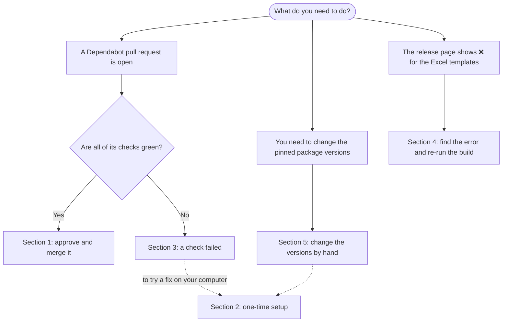

# Excel template maintenance guide

This guide is for anyone on the data management team (BDMs) who needs to keep the Excel template build working. It assumes Python 3.11 or newer is already installed.

**Where to start:**



The sections are linked in the contents below.

**Contents**
- [How the Excel build works](#how-the-excel-build-works)
- [1. Handle the monthly Dependabot pull request](#1-handle-the-monthly-dependabot-pull-request)
- [2. Set up your computer to run the tests (one time)](#2-set-up-your-computer-to-run-the-tests-one-time)
- [3. A check failed on a Dependabot pull request](#3-a-check-failed-on-a-dependabot-pull-request)
- [4. The release page shows ❌ for the Excel templates](#4-the-release-page-shows--for-the-excel-templates)
- [5. Change the pinned package versions by hand (rare)](#5-change-the-pinned-package-versions-by-hand-rare)
- [6. Who can do what, and who to ask](#6-who-can-do-what-and-who-to-ask)
- [Files involved](#files-involved)

---

## How the Excel build works

1. When a release is promoted to a full release, the **register-schema** workflow registers the JSON schemas in `sage.schemas.ad`.
2. That automatically starts the **Build Excel templates** workflow. It builds one Excel workbook per template and uploads each one to the [AD Metadata Dictionary folder](https://www.synapse.org/Synapse:syn25878249) on Synapse as a new version of the existing file.
3. While it runs, the **release page** shows an **Excel templates** section at the end of the release notes: ⏳ building, then ✅ uploaded or ❌ failed. The section also lists any open Dependabot pull requests.

The build uses Python packages (mainly `openpyxl`, which writes the Excel files, and `synapseclient`, which uploads them). To keep releases predictable, the build always installs **the exact same versions**, listed in `scripts/requirements-excel-templates.txt`. Those versions only change when someone merges a pull request that changes them, usually one opened by **Dependabot**.

**Dependabot** is a GitHub bot. On the 1st of each month it opens a pull request that updates those package versions. Tests run on that pull request automatically, so a package update that would break the build shows up as a red check on the pull request instead of during a release. **Nobody is notified when Dependabot opens a pull request,** so checking for it is a monthly task, separate from releases (see [Monthly Maintenance](../README.md#monthly-maintenance) in the README).

---

## 1. Handle the monthly Dependabot pull request

**Find it.** Open the [pull requests from Dependabot](https://github.com/adknowledgeportal/data-models/pulls/app%2Fdependabot). If the list is empty, there's nothing to do this month. Usually there is at most one, titled something like **Excel templates: Bump the excel-template-packages group in /scripts with 3 updates**.

**Handle it:**

1. **Assign it to yourself** so others know you have it. Open the pull request; in the right-hand column under **Assignees**, click **assign yourself**.
2. **Look at the checks** at the bottom of the **Conversation** tab.
   - **All green ✅:** go to step 3.
   - **Any red ❌:** don't merge. Go to [Section 3](#3-a-check-failed-on-a-dependabot-pull-request). Nothing is broken meanwhile: until this pull request is merged, the build keeps using the current versions, which work.
   - **Still running (yellow):** wait a few minutes. The tests take about 2 minutes.
3. **Check what changed.** Click the **Files changed** tab. For the monthly Excel update, the only file changed should be `scripts/requirements-excel-templates.txt`, with version numbers and long `--hash=sha256:` lines. If anything else changed, don't merge, and ask in the team channel.
4. **Approve it.** Still on **Files changed**, click **Review changes** (top right), choose **Approve**, then **Submit review**.
5. **Merge it.** Go back to the **Conversation** tab, click **Squash and merge**, then **Confirm squash and merge**.
   - If the merge button is grey and says the `generate-and-register-schemas` check is **Expected — Waiting for status to be reported**, ask a repository admin to merge it (see [Section 6](#6-who-can-do-what-and-who-to-ask)).
6. **That's it.** The next release's Excel build will use the new versions. If that build fails, the update is a likely cause; see [Section 4](#4-the-release-page-shows--for-the-excel-templates).

**Other Dependabot pull requests.** Dependabot also opens *security* update pull requests when a package has a known vulnerability. Handle them the same way. If one changes only `requirements.txt` at the top of the repository (not in `scripts/`), it doesn't affect the Excel build; merge it if its checks are green.

---

## 2. Set up your computer to run the tests (one time)

You only need this to investigate or fix a failure on your own computer. You can handle a green Dependabot pull request without it.

**You need:** Python 3.11 or newer, and Git. To check, run `python3 --version` (Mac) or `python --version` (Windows), and `git --version`. If Git is missing, install it from [git-scm.com](https://git-scm.com/downloads) and use the default options.

**Open a terminal:**
- **Mac:** open **Terminal** (Applications → Utilities → Terminal).
- **Windows:** open **PowerShell**, Windows' built-in terminal (Start menu → type "PowerShell"). The Windows commands in this guide are written for PowerShell; a few of them (such as `$env:` and `Activate.ps1`) don't work in the older Command Prompt.

**Download the repository and install the packages.** Copy one line at a time.

Mac (Terminal):
```bash
cd ~/Documents
git clone https://github.com/adknowledgeportal/data-models.git
cd data-models
python3 -m venv .venv
source .venv/bin/activate
pip install -r scripts/requirements-excel-templates.in
```

Windows (PowerShell):
```powershell
cd $HOME\Documents
git clone https://github.com/adknowledgeportal/data-models.git
cd data-models
python -m venv .venv
.venv\Scripts\Activate.ps1
pip install -r scripts/requirements-excel-templates.in
```

> **Windows:** if `Activate.ps1` gives an error about running scripts being disabled, run `Set-ExecutionPolicy -Scope CurrentUser RemoteSigned`, answer `Y`, then run `.venv\Scripts\Activate.ps1` again.

`.venv` is a private Python environment for this repository, so these packages don't affect anything else on your computer. When it's active, your prompt starts with `(.venv)`.

**Run the tests** (same command on Mac and Windows):
```bash
python -m pytest tests -v
```
Each test prints `PASSED` or `FAILED`, and the last line gives the totals, for example `20 passed`.

**Next time**, you only need to go to the folder, get the latest changes and turn the environment back on:

| | Mac | Windows |
|---|---|---|
| Go to the folder | `cd ~/Documents/data-models` | `cd $HOME\Documents\data-models` |
| Get the latest changes | `git switch main` then `git pull` | `git switch main` then `git pull` |
| Turn on the environment | `source .venv/bin/activate` | `.venv\Scripts\Activate.ps1` |

**Try the exact package version from a Dependabot pull request.** On the pull request's **Files changed** tab, find the package and its new version, for example `openpyxl==3.2.0`. Then run (same on Mac and Windows):
```bash
pip install "openpyxl==3.2.0"
python -m pytest tests -v
```

---

## 3. A check failed on a Dependabot pull request

**Don't merge the pull request.** Nothing is broken yet: the release build keeps using the current versions until a new one is merged.

**Find out which test failed.** At the bottom of the pull request, click **Details** next to the red **Test Excel templates** check. Expand the red step and scroll to the end; look for lines starting with `FAILED`, for example:

```
FAILED tests/test_create_excel_templates.py::test_default_font_is_arial - AssertionError: ...
```

Then find the failure below.

### 3a. `test_default_font_is_arial` or `test_set_default_font_still_works_with_this_openpyxl`

**What it means:** the new version of **openpyxl** changed something the script relies on to set the workbook's default font (Arial 10). openpyxl has no official way to do this, so the script uses one of its internal settings, which an update can change.

**How much it matters:** very little for the templates themselves. Every cell the templates use (the header, the 1,000 manifest rows and the data dictionary) sets Arial 10 directly. Only empty cells outside those areas use the default font. But if the test reports an `AttributeError`, the whole build would stop, so don't merge.

**Option A: skip this openpyxl version (quick; do this first).**
1. On the pull request, add a comment with exactly this text, then click **Comment**:
   ```
   @dependabot ignore openpyxl minor version
   ```
   (If only the last number of the version changed, for example `3.1.5` → `3.1.6`, use `patch version` instead of `minor version`.)
2. Dependabot updates or replaces the pull request without the openpyxl update. When the new checks are green, handle it as in [Section 1](#1-handle-the-monthly-dependabot-pull-request).
3. Create a ticket so someone can come back to it (Option B). Include a link to the failed check.

**Option B: fix the script (when someone has time).** This needs [Section 2](#2-set-up-your-computer-to-run-the-tests-one-time).
1. Install the new openpyxl version and run the tests to see the failure on your computer (end of Section 2).
2. Open `scripts/create_excel_templates.py` in any text editor and find the function `set_default_font`. It has one line that does the work:
   ```python
   wb._named_styles["Normal"].font = Font(name="Arial", size=10)
   ```
3. Look in the [openpyxl release notes](https://openpyxl.readthedocs.io/en/stable/changes.html) for a change to "named styles" and update that line to match.
4. **If you can't find a fix, removing the line is acceptable** (see "How much it matters" above). Replace the line with `pass`. Then, in `tests/test_create_excel_templates.py`, delete the two functions `test_default_font_is_arial` and `test_set_default_font_still_works_with_this_openpyxl` (each starts with `def` and runs until the next `def`).
5. Run `python -m pytest tests -v` until everything passes, then put the change on the pull request (see [Push a fix to a pull request](#push-a-fix-to-a-pull-request) below).
6. If you used `@dependabot ignore` earlier, comment `@dependabot unignore openpyxl` so Dependabot offers the update again.

### 3b. `test_synapseclient_still_has_what_upload_uses`

**What it means:** the new version of **synapseclient** renamed something the upload step uses. The message lists what's missing, for example `File.store`. If merged, the build would build the workbooks but fail to upload them.

**Option A: skip this synapseclient version.** As in 3a, but comment `@dependabot ignore synapseclient minor version`.

**Option B: fix the script.**
1. Read the [synapseclient release notes](https://python-docs.synapse.org/en/stable/news/) for the version in the pull request, and find the new name for what's missing.
2. In `scripts/create_excel_templates.py`, update the `upload` function to use the new name. Then update the same name in the test.
3. The upload can't be tested automatically because it needs a Synapse login, so **test it for real against a test folder you own** (never the real AD Metadata Dictionary folder). In Synapse, create an empty folder in a project you own and copy its Synapse ID (it starts with `syn`). Create a Synapse personal access token under **Account Settings → Personal Access Tokens** if you don't have one. Then:

   Mac (Terminal):
   ```bash
   export SYNAPSE_AUTH_TOKEN="paste-your-token-here"
   python scripts/create_excel_templates.py --folder-id syn00000000
   ```
   Windows (PowerShell):
   ```powershell
   $env:SYNAPSE_AUTH_TOKEN = "paste-your-token-here"
   python scripts/create_excel_templates.py --folder-id syn00000000
   ```
   Replace `syn00000000` with your test folder's ID. It should end with `Done: … template(s) uploaded`, and the files should appear in your folder. Run it a second time: the same files should get version 2.
4. Push the fix to the pull request (below).

### 3c. The "Build the newest release's templates (dry run)" step failed

This step builds the real templates without uploading them. Read the last red lines:
- **`Connection`, `timed out`, `502`, `503` or `504`:** Synapse or GitHub had a hiccup. Click **Re-run jobs** (top right of the check's page) → **Re-run failed jobs**.
- **Anything else:** the new package versions break the build in a way the tests didn't catch. Find which package changed the most on the **Files changed** tab, then use Option A from 3a with that package's name, and create a ticket.

### 3d. The "Install dependencies" step failed

If the message mentions `hashes` or `Could not find a version`, the versions file wasn't generated correctly. Regenerate it as in [Section 5](#5-change-the-pinned-package-versions-by-hand-rare). If it's on a Dependabot pull request, close that pull request instead (**Close pull request** at the bottom); Dependabot opens a new one next month.

### 3e. Any other test failed

The test's message says what's wrong. If it isn't clear, use Option A from 3a for the package that changed, create a ticket with a link to the failed check, and ask for help (Section 6).

### Push a fix to a pull request

From your terminal, in the `data-models` folder with `.venv` turned on. The pull request's branch name is shown under its title, for example `dependabot/pip/scripts/excel-template-packages-1a2b3c`. Use your own branch name in place of that one (same commands on Mac and Windows):

```bash
git fetch origin
git switch dependabot/pip/scripts/excel-template-packages-1a2b3c
```

Make and test your change, then:

```bash
git add scripts tests
git commit -m "Fix the Excel template build for the new package versions"
git push
```

The checks run again on the pull request. When they're green, ask another BDM to approve it, since you can't approve a pull request you've pushed to. Then merge.

---

## 4. The release page shows ❌ for the Excel templates

**What it means:** the Excel templates on Synapse were **not updated for this release**, and won't be until the problem is fixed and the build is re-run. **The rest of the release isn't affected:** the schemas are registered, and you can carry on with Core Models (Step 4) and the announcement (Step 5). In the announcement, mention that the Excel templates will follow.

**Find the error.** Click **workflow run** in the ❌ message. The errors are listed at the top of the run's **Summary** page. For the full log, click the job, then the red step.

| The error mentions… | Likely cause | What to do |
|---|---|---|
| `Connection`, `reset`, `timed out`, `500`, `502`, `503`, `504` | Synapse was busy or briefly down | Re-run the build ([4a](#4a-re-run-the-build)). Templates that already uploaded get one more version with the same labels, which is harmless. |
| `401`, `403`, `Unauthorized`, `Forbidden`, `login` | The Synapse token (`SYNAPSE_TOKEN_DPE`) expired or lost access to the folder | Ask the DPE team, who owns that token, to renew it, and a repository admin to update the secret. Then re-run ([4a](#4a-re-run-the-build)). |
| `ModuleNotFoundError`, `ImportError`, `AttributeError`, or the **Install dependencies** step failed, right after a Dependabot merge | The package update broke the build | Undo the update ([4b](#4b-undo-a-dependabot-update)), then re-run ([4a](#4a-re-run-the-build)). |
| `No sage.schemas.ad schemas registered at …` | The schemas weren't registered yet, or registration failed | Check that the **Generate, register … Schemas** run for the release succeeded, then re-run ([4a](#4a-re-run-the-build)). |
| `Couldn't read AD.model.csv` | The release's tag is missing, or GitHub was briefly down | Check the release has a tag like `v2.0.0`, then re-run ([4a](#4a-re-run-the-build)). |
| `isn't the newest registered version` | A manual run asked to upload an older release | Re-run with the version box blank ([4a](#4a-re-run-the-build)). |
| `Couldn't tell which org run … registered to` | The register-schema workflow's messages changed | Run the build by hand meanwhile ([4a](#4a-re-run-the-build)), and create a ticket for a developer. |
| `[SomeTemplate] failed: …` for one or two templates | A problem with those templates' schemas | The other templates were uploaded. Send the error to the data model lead. |

### 4a. Re-run the build

1. Go to the repository's **Actions** tab and click **Build Excel templates** in the left-hand list.
2. Click **Run workflow** (right side). Leave the branch as `main` and the version box **blank** (it uses the newest release).
3. Leave **Build only, don't upload** checked for a first try, and click the green **Run workflow** button. This checks that the build works without uploading anything.
4. When that run has a green ✅, click **Run workflow** again, **uncheck** the box, and run it. This uploads the templates, and the release page's Excel templates section changes to ✅.

### 4b. Undo a Dependabot update

1. Open the Dependabot pull request that was merged (it's under **Pull requests** → **Closed**).
2. Click **Revert** near the bottom. GitHub creates a new pull request that undoes it; click **Create pull request**.
3. Ask another BDM to approve it (you can't approve your own), then merge it.
4. Re-run the build ([4a](#4a-re-run-the-build)).
5. Create a ticket with a link to the failed run, so the update can be fixed and tried again (Section 3).

---

## 5. Change the pinned package versions by hand (rare)

You only need this to allow a new **major** version of a package (Dependabot stays within the version ranges set in the `.in` file, so for example openpyxl 4 has to be allowed on purpose), or to repair the versions file.

There are two files:
- `scripts/requirements-excel-templates.in`: the packages the script uses and the range of versions it supports, for example `openpyxl>=3.1,<4`. **Edit this one.**
- `scripts/requirements-excel-templates.txt`: generated from the `.in`, with every package (including the ones those packages need) at an exact version, with security hashes. **Never edit this one by hand.**

1. Set up as in [Section 2](#2-set-up-your-computer-to-run-the-tests-one-time), then create a branch for your change (same on Mac and Windows):
   ```bash
   git switch main
   git pull
   git switch -c update-excel-template-packages
   ```
2. Edit `scripts/requirements-excel-templates.in` if needed.
3. Install the tool that generates the `.txt`, then generate it. Mac and Windows use the same commands; run them from the `data-models` folder:
   ```bash
   pip install pip-tools
   cd scripts
   pip-compile --allow-unsafe --generate-hashes --strip-extras --output-file=requirements-excel-templates.txt requirements-excel-templates.in
   cd ..
   ```
   Use Python 3.11 if you have it, since that's what the build uses. If you use a different version, the pull request's **Install dependencies** step tells you if anything is missing.
4. Install the new versions and run the tests:
   ```bash
   pip install -r scripts/requirements-excel-templates.in
   python -m pytest tests -v
   ```
5. Commit, push, and open a pull request:
   ```bash
   git add scripts/requirements-excel-templates.in scripts/requirements-excel-templates.txt
   git commit -m "Update the Excel template build's packages"
   git push -u origin update-excel-template-packages
   ```
   The `git push` output prints a link to open the pull request. Another BDM approves it and either of you merges it.

---

## 6. Who can do what, and who to ask

**Any BDM** (member of the `adtr-dcc` GitHub team, which has Maintain access) can do everything in this guide, except:
- approving a pull request you opened or pushed changes to (another BDM approves it)
- merging a pull request from a fork, or one stuck waiting for the `generate-and-register-schemas` check (a repository admin)
- changing repository secrets such as `SYNAPSE_TOKEN_DPE` (a repository admin)

**Who to ask:**
- **Help with a failure, or a second approval:** the other BDMs on the ADTR data management team.
- **The `SYNAPSE_TOKEN_DPE` token, or the register-schema workflow:** the DPE team.
- **Repository admins:** listed under the repository's **Settings → Collaborators and teams** (visible to admins and maintainers).

---

## Files involved

| File | What it is |
|---|---|
| [`scripts/create_excel_templates.py`](../scripts/create_excel_templates.py) | Builds the workbooks and uploads them |
| [`scripts/excel_templates_release_status.py`](../scripts/excel_templates_release_status.py) | Writes the Excel templates section on the release page |
| [`scripts/requirements-excel-templates.in`](../scripts/requirements-excel-templates.in) | Packages the build uses, and the versions it supports (edit this) |
| [`scripts/requirements-excel-templates.txt`](../scripts/requirements-excel-templates.txt) | Exact versions the build installs (generated; don't edit) |
| [`tests/`](../tests) | The tests |
| [`.github/workflows/build-excel-templates.yml`](../.github/workflows/build-excel-templates.yml) | Runs the build after each release, or by hand |
| [`.github/workflows/test-excel-templates.yml`](../.github/workflows/test-excel-templates.yml) | Runs the tests on pull requests |
| [`.github/dependabot.yml`](../.github/dependabot.yml) | Tells Dependabot to open the monthly update pull request |
| [CI/CD documentation](../.github/workflows/README.md#build-excel-templates-workflow) | More detail on the build workflow |
